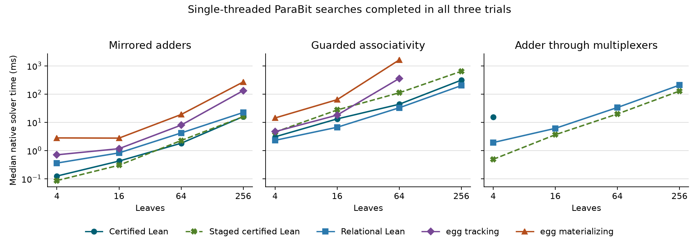

# Larger single-threaded benchmarks

These experiments scale individual programs and goals. The ParaBit inputs are generated generalizations of BWLang identities. The verified compiler passes operate on open register IR. The graph workloads exercise recursive closure, a cyclic self-join, the repository's calculus rewrites and its JSON parsing grammar. All runs use the same Apple M4 Max as the [original corpus comparison](../parabit/README.md).

## What the ParaBit inputs measure

- **Mirrored adders** reverse the operands at every addition in a balanced tree. Each level has its own symbolic width and each leaf is a different input word.
- **Guarded associativity** puts an independent ROVER `add_assoc_4` at each leaf of a selector tree. The branches share the four published width inequalities. A goal with 256 leaves contains 10,740 AST occurrences across its two sides.
- **Adder through multiplexers** factors a tree of selected sums into one addition of two selector trees. The proof must relate the selections across several levels.

The primary sweep uses 4, 16, 64 and 256 leaves, 12 certified rounds, 12 relational simplification rounds, three randomized trials, five seconds of process wall time and a sampled 8 GiB resident-memory limit per trial. Every input passes the original solver's validator. Each family also has a four-leaf negative control. Its manifest gives an assignment satisfying the premises that changes the answer from 1 to 0. [Generator](../parabit/scale.py) · [Input sizes and witnesses](../parabit/results/scale-manifest.csv) · [Primary samples](../parabit/results/scale.csv) · [Negative controls](../parabit/results/scale-negative.csv)

### Native ParaBit solver performance

With the default schedules, relational Lean solved all 12 scaled equalities in every trial, certified Lean solved nine, and the authors' explanation-enabled `egg` solved seven consistently. On the seven consistently shared successes, the geometric mean of per-input certified Lean time divided by `egg` time was 0.270× for explanation tracking and 0.090× for materialization. The modes use different solving strategies.

| Family | Leaves | Certified Lean (ms) | Relational Lean (ms) | egg tracking (ms) | egg materializing (ms) |
|---|---:|---:|---:|---:|---:|
| Mirrored adders | 4 | 0.125 | 0.360 | 0.706 | 2.798 |
| | 16 | 0.423 | 0.824 | 1.163 | 2.749 |
| | 64 | 1.808 | 4.187 | 7.919 | 18.820 |
| | 256 | 15.911 | 22.206 | 131.890 | 267.344 |
| Guarded associativity | 4 | 3.058 | 2.297 | 4.662 | 14.208 |
| | 16 | 13.166 | 6.658 | 17.963 | 63.158 |
| | 64 | 43.436 | 32.569 | 355.171 | 1,611.672 |
| | 256 | 310.163 | 198.911 | 1 of 3 | timeout |
| Adder through multiplexers | 4 | 15.547 | 1.918 | timeout | timeout |
| | 16 | timeout | 6.092 | timeout | timeout |
| | 64 | timeout | 33.290 | timeout | timeout |
| | 256 | timeout | 206.717 | timeout | timeout |

Each numeric cell is the median native solver time from three completed searches. A timeout cell means all three processes reached the five-second wall limit. Tracking found the 256-site guarded equality once in 3.645 s. At each size the inputs are identical across modes. The final two Lean modes were remeasured together after the engine changes. Host CPU idle checks ranged from 69.0% to 98.9% for the initial sweep and 80.2% to 96.1% for the final Lean runs and corpus checks. [Timing boundaries](../parabit/README.md) · [All trials](../parabit/results/scale.csv)



With a 60-second wall limit and the same 8 GiB memory cap, `egg` found the 256-site guarded equality in 3.695 s and materialized its explanation in 12.924 s in a separate run. For the mux family at the same limits, the default certified schedule hit the memory ceiling after 44.414 s at 16 leaves. The 64- and 256-leaf goals reached the 60-second wall limit. Each extended result is a single trial. The four-leaf controls have explicit counterexamples. Both `egg` modes timed out on all three. Relational Lean exhausted its bounded schedule on all three. Certified Lean returned unproved for the adder and associativity mutations and timed out on the mux mutation. The final native binaries also reproduced their original 163 successes on all 165 published cases. [Long runs](../parabit/results/scale-extended.csv) · [Controls](../parabit/results/scale-negative.csv)

With `ART`, `G` and `OUT` set as in the reproduction commands below, the two long-run commands reproduce the measurement budgets. The `egg-coverage` mode records whether search succeeded before running the same materialization calls as `egg-explain`.

```sh
python3 lean/parabit/scale.py run "$ART" "$G" "$OUT/extended-guarded.csv" --family guarded-assoc --sizes 256 --mode egg-track --mode egg-coverage --trials 1 --seconds 60 --no-warmup
python3 lean/parabit/scale.py run "$ART" "$G" "$OUT/extended-mux.csv" --family mux-add --sizes 16 64 256 --mode lean-cert --trials 1 --seconds 60 --no-warmup
```

### Effect of the certified rewrite schedule

The mux experiment exposed a difference between the rule sets. Both include a rule that distributes addition through two muxes with the same selector. The default certified solver can also distribute an arbitrary addend through a single mux and reassociate sums from the first round. The relational solver has a width analysis for selectors and delays reassociation. To test whether staging helps, the optional certified schedule first propagates widths and fires paired-selector and truncation rules. It uses the existing graph if it proceeds to the general algebraic phase. The guard on the new width transfer requires both branches to fit. Each phase gets up to 12 rounds under the same total five-second process budget. This experiment changed both rule selection and order. [Proved rules and schedule](../Egglog/Examples/ParaBit.lean) · [Kernel-checked example and counterexample](../ParaBitSourceTests.lean)

| Staged certified solver | 4 leaves (ms) | 16 leaves (ms) | 64 leaves (ms) | 256 leaves (ms) |
|---|---:|---:|---:|---:|
| Mirrored adders | 0.086 | 0.302 | 2.257 | 15.791 |
| Guarded associativity | 4.490 | 27.268 | 110.569 | 639.310 |
| Adder through multiplexers | 0.488 | 3.626 | 19.675 | 127.617 |

All 12 equalities succeeded in all three trials. At 256 leaves the staged solver proved mux factoring in 128 ms, compared with a 60-second timeout on the default schedule. Guarded associativity at that size took 639 ms with staging and 310 ms with the default. On the seven consistent shared successes, the staged solver took 0.337× the authors' tracking time and 0.112× their materialization time by paired geometric mean. A compiler can select either schedule and use the returned theorem about the source AST. [Staged sweep](../parabit/results/scale-staged.csv) · [Controls](../parabit/results/scale-staged-negative.csv)

At four leaves the staged solver returned unproved on both the mirrored-adder and associativity mutations. The mux mutation reached its five-second limit. On the original published corpus, the staged solver matched every default classification under the original two-second process limit and six-round bound, with 163 successes and the two known Hydra counterexamples unresolved. [Original corpus with staged search](../parabit/results/staged-corpus.csv)

### Same ParaBit theory in plain Rust and Lean

For each generated goal, both raw interpreters received byte-for-byte identical egglog declarations, rules, schedule, inputs and final equality check. All 12 positive goals succeeded and all three negative controls failed the equality check as expected in every trial. These times cover the entire CLI process. Ten of the 12 positive medians were within 1.30× plain Rust. The paired geometric mean across the 12 was 0.914×. At 256 leaves, guarded associativity and mux factoring exceeded the target. [Paired samples](../parabit/results/scale-raw.csv)

| Positive family | 4 leaves | 16 leaves | 64 leaves | 256 leaves | 256-leaf Lean / Rust wall time |
|---|---:|---:|---:|---:|---:|
| Mirrored adders | 0.72× | 0.68× | 0.66× | 0.76× | 35.1 / 45.9 ms |
| Guarded associativity | 0.76× | 0.92× | 0.97× | 1.41× | 244.0 / 172.5 ms |
| Adder through multiplexers | 0.71× | 0.90× | 1.296× | 1.73× | 237.7 / 137.3 ms |

### Standalone kernel replay

Every success of the certified solver returns a proof of equivalence for the original BWLang expressions and every input assignment satisfying their width premises. Its native runtime erases that proof. To measure the cost of independently checking a concrete theorem, we exported and replayed each of the nine consistently successful goals in a fresh Lean process, with 30 seconds and 8 GiB for each phase. Four theorems passed. The largest was the 16-leaf mirrored adder, with 186 source AST occurrences across the two sides. Export took 47 ms and the kernel took 9.38 s. The four-leaf mirrored adder, guarded associativity and mux also passed, in 1.01, 11.70 and 8.51 s of kernel time. [Per-goal export and kernel outcomes](../parabit/results/scale-kernel.csv) · [Source theorem and certificate format](../parabit/README.md)

The kernel reached its memory ceiling on mirrored adders of 64 and 256 leaves and on guarded associativity at 16 and 64 leaves. The 256-site guarded proof exceeded the export time budget. Independent check costs are excluded from both the native Lean solver time and the authors' native explanation-materialization time.

For the alternate schedule we also exported all four mux goals and asked the kernel to evaluate `Problem.proveStaged?` directly. All four exports succeeded, including the 256-leaf source theorem in 202 ms. All four kernel processes then reached 8 GiB. The default exporter's ground-rule replay verified the four-leaf mux within the same memory limit. A native staged success uses the universally proved solver and the ordinary proof-erasure model. Independently replaying one of these generated staged mux theorems remains expensive. [Staged export and kernel outcomes](../parabit/results/scale-staged-kernel.csv)

## Verified compiler passes

The Boolean and guarded strength-reduction compiler passes time insertion of a native AST, equality saturation, extraction and decoding. Both runners compare the entire result against the expected AST. The Rust timer stops while its graph is still in scope. The process-level measurements include startup, parsing, output checking and teardown. [Compiler harness](compiler.py)

| Pass | Leaves | Lean median (ms) | Plain Rust median (ms) | Lean/Rust |
|---|---:|---:|---:|---:|
| Boolean | 4,096 | 12.24 | 10.76 | 1.14× |
| Boolean | 16,384 | 59.74 | 45.00 | 1.33× |
| Boolean | 65,536 | 262.32 | 195.38 | 1.34× |
| Guarded strength reduction | 4,096 | 7.60 | 5.97 | 1.27× |
| Guarded strength reduction | 16,384 | 34.58 | 24.46 | 1.41× |
| Guarded strength reduction | 65,536 | 175.09 | 114.98 | 1.52× |

The largest Boolean input had 720,895 constructor occurrences and the largest strength-reduction input had 327,678. Both engines returned the expected AST in every run. At 65,536 leaves, median peak RSS was 384/376 MiB for Boolean and 253/216 MiB for strength reduction (Lean/Rust). The final run used one warmup and five measured trials with both engines interleaved. CPU idle checks were 85.1–94.9%. [All compiler trials](results/large-compiler.csv)

## Relational queries and calculus saturation

The graph harness checks both table cardinalities and membership witnesses. Dense triangles use a directed tripartite graph. Each triple of vertices produces three ordered answers. The skewed input consists of triangles sharing a hub, with just six ordered answers per blade. JSON parsing uses the repository's complete grammar and original token streams. The adapter identifies spans by their endpoints so that the split position is a join key. Both engines receive the same program, with CSV rows loaded before timing. [Graph harness](large_graph.py) · [JSON adapter](cyk.py)

For graph timings, the child signals when setup is complete, waits for the parent to release it, and signals again when the schedule finishes. The parent times this interval using one monotonic clock. Checks and teardown follow the second signal. Sample ledgers also report whole-process wall time, process CPU time and the child's own clock. During the pilot some child clocks jumped well beyond process lifetime. The revised benchmark uses the parent-observed interval for comparisons. The original Rust length/start JSON grammar independently produced the same seven table cardinalities and accepted both complete token streams.

| Graph workload | Size | Checked result | Lean schedule (ms) | Rust schedule (ms) | Lean/Rust |
|---|---:|---:|---:|---:|---:|
| Path closure | 512 edges | 131,328 paths | 18.65 | 27.21 | 0.69× |
| Path closure | 1,024 edges | 524,800 paths | 72.71 | 87.90 | 0.83× |
| Path closure | 2,048 edges | 2,098,176 paths | 377.86 | 358.13 | 1.06× |
| Dense triangles | 16 per partition | 12,288 triangles | 3.80 | 1.55 | 2.45× |
| Dense triangles | 32 per partition | 98,304 triangles | 14.17 | 7.68 | 1.85× |
| Dense triangles | 64 per partition | 786,432 triangles | 149.10 | 54.17 | 2.75× |
| Shared-hub triangles | 256 blades | 1,536 triangles | 1.02 | 0.62 | 1.65× |
| Shared-hub triangles | 1,024 blades | 6,144 triangles | 3.99 | 2.07 | 1.93× |
| Shared-hub triangles | 4,096 blades | 24,576 triangles | 15.43 | 8.19 | 1.88× |
| Calculus saturation | 12 rounds | 15,987,528 constructor rows | 5,625.73 | 4,688.78 | 1.20× |
| JSON parsing | 801 tokens | 3,218 chart entries | 40.83 | 2.37 | 17.23× |
| JSON parsing | 7,821 tokens | 36,023 chart entries | 1,553.96 | 23.16 | 67.09× |

All 96 runs (one warmup and three measured trials per engine and size) passed. Total process latency also matters on generated input files. For the largest shared-hub graph, median process time was 2,076 ms in Lean and 118 ms in Rust including parsing and seeding the edges. For calculus it was 5,737 ms versus 5,723 ms. CPU idle checks ranged from 80.5% to 94.9%. [Per-trial schedule, wall and CPU measurements](results/large-engine.csv)

The shared-hub input revealed that sibling matches repeatedly built the same column index. Reusing partitions of narrowed inputs reduced Lean's median schedule time from 8,726 ms to 15.43 ms. The JSON grammar exposed repeated full searches as its parse-tree function grew. The interpreter now joins newly appended function and constructor rows incrementally, rescans a function when an existing result changes, and invalidates the cutoffs on e-class merges. JSON parsing still has the largest relative slowdown in this suite. [Pilot hub samples](results/windmill-pilot.csv) · [Join implementation](../Egglog/GenericJoin.lean) · [Mixed-source evaluation](../Egglog/Relations.lean)

One source of the JSON scaling gap is visible in the round loop. The largest array grows from 10 elements in the small input to 100 in the medium input, and the grammar prepends one element per round. Even when no tokens change, each round walks the entire token function to build its join input before applying the delta cutoff. The larger case consequently reconstructs at least 774,279 token rows across those 99 rounds, in addition to scanning the growing parse-tree function. Persistent indexes and row ranges across rounds would avoid this repeated work. Its share of the 1.55 s total has not been isolated. [Grammar](../../tests/cykjson_Prod.csv) · [Row materialization](../Egglog/Relations.lean)

Three other repository workloads were tried unchanged in this sweep. That version of the raw interpreter stopped before saturation on `tests/eggcc-2mm.egg` (primitive sort `bool`), `tests/repro-herbie-vanilla.egg` (`BigRat`), and `tests/gemma.egg` (`include`). They have no timing ratio here. The [subsequent eggcc 2mm study](Advanced.md) runs the complete input DAG through its region and context analyses and documents the remaining full-program blockers.

We also reran the original 2,000-expression arithmetic tests, 128-edge path, 11-round calculus and the two compiler passes at 128 and 1,024 leaves. All ten configurations passed their result checks and the 1.30× threshold on five measured trials after one warmup. Ratios ranged from 0.44× on the short path to 1.20× on 1,024-leaf strength reduction.

## Reproduction

From the repository root, set `ART` to the pinned ParaBit checkout from the [corpus setup](../parabit/README.md). Set `OUT` to a new results directory.

```sh
mkdir -p "$OUT"
G="$OUT/generated/benchmarks"
cargo build --release --locked --bin egglog --example lean_comparison
(cd lean && lake build lean-egglog compiler-bench parabit-certified parabit-relational)
python3 lean/parabit/scale.py generate "$G" --sizes 4 16 64 256 --controls
python3 lean/parabit/scale.py run "$ART" "$G" "$OUT/scale.csv" --trials 3 --seconds 5
python3 lean/parabit/scale.py run "$ART" "$G" "$OUT/negative.csv" --sizes 4 --only-controls --trials 1 --seconds 5
python3 lean/parabit/scale.py run "$ART" "$G" "$OUT/scale-staged.csv" --mode lean-staged --trials 3 --seconds 5
python3 lean/parabit/scale.py run "$ART" "$G" "$OUT/scale-staged-negative.csv" --mode lean-staged --sizes 4 --only-controls --trials 1 --seconds 5
python3 lean/parabit/compare.py run "$ART" "$OUT/staged-corpus.csv" --mode lean-staged --cert-rounds 6 --seconds 2 --trials 1
python3 lean/parabit/plot_scale.py "$OUT/scale.csv" "$OUT/scale.png" --staged "$OUT/scale-staged.csv"
python3 lean/parabit/compare_raw.py "$G" "$OUT/scale-raw.csv" --manifest "$G/manifest.csv" --control-size 4
python3 lean/bench/compiler.py --size 4096 16384 65536 --runs 5 --warmup 1 --csv "$OUT/large-compiler.csv"
python3 lean/bench/large_graph.py "$OUT/large-engine.csv"
```

The independent kernel audit takes the same nine scaled goals that completed in every certified native trial. The command records each export and kernel outcome, including time and memory limits. It returns a failing exit status if a resource limit fires.

```sh
set --
for family in mirror-add guarded-assoc; do
    for leaves in 0004 0016 0064 0256; do
        set -- "$@" --case "$family/bwlang/$family-$leaves.bwlang"
    done
done
python3 lean/parabit/check-kernel.py corpus "$OUT/generated" "$OUT/scale-kernel.csv" \
    --rounds 12 --export-seconds 30 --seconds 30 --retry-seconds 0 --check-load \
    "$@" --case mux-add/bwlang/mux-add-0004.bwlang

set --
for leaves in 0004 0016 0064 0256; do
    set -- "$@" --case "mux-add/bwlang/mux-add-$leaves.bwlang"
done
python3 lean/parabit/check-kernel.py corpus "$OUT/generated" "$OUT/scale-staged-kernel.csv" \
    --staged --rounds 12 --export-seconds 30 --seconds 30 --retry-seconds 0 --check-load "$@"
```
